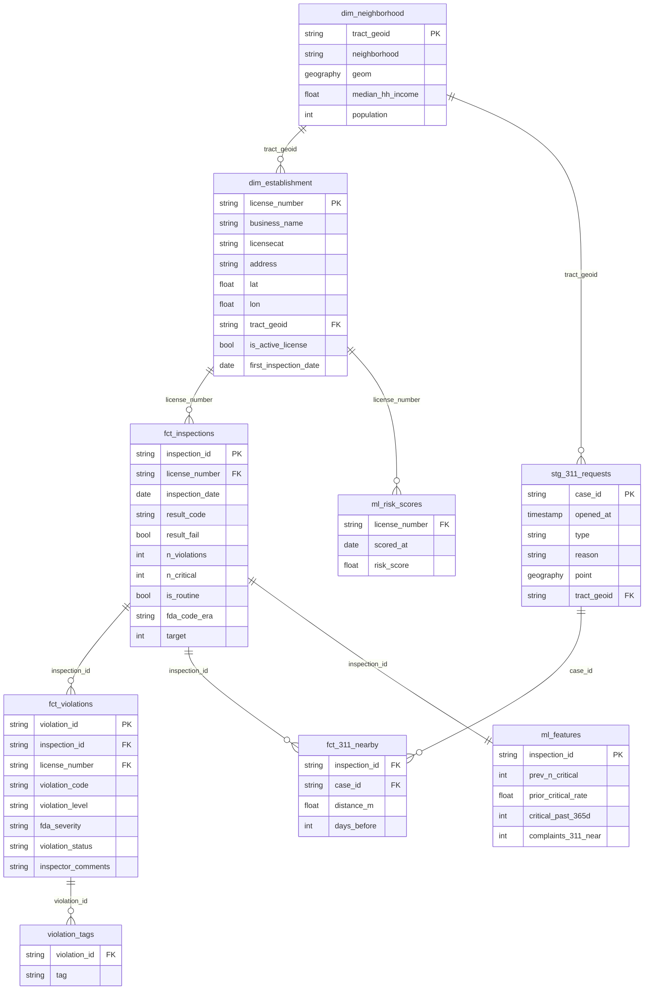

# Data Model

How our BigQuery tables connect, from raw sources to the marts used by the dashboard, ML and the app.
Raw column names and match rates come from the 2026-10-13 landing snapshot
(`ml/notebooks/01_eda_target_baseline.ipynb`). Mart columns are a proposal for the dbt layer.

The one shared key is `license_number` (`licenseno` in raw). Inspections and violations carry it directly.
Licenses, 311, neighborhoods and Census data don't, so they are linked by name matching or by location.

## Layers

| raw | staging | intermediate | marts |
|---|---|---|---|
| `food_inspections` | `stg_food_inspections` | `int_inspections` | `dim_establishment` |
| `food_licenses` | `stg_food_licenses` | `int_license_crosswalk` | `dim_neighborhood` |
| `requests_311_legacy` | `stg_311_requests` | `int_establishment_geo` | `fct_inspections` |
| `neighborhoods` | `stg_neighborhood_tracts` | `int_311_geo` | `fct_violations` |
| `acs_tract` (not ingested) | `stg_acs_tract` | | `fct_311_nearby` |
| | | | `ml_features` |
| | | | `ml_risk_scores` (Phase 2) |
| | | | `violation_tags` (Phase 3) |

## Marts

| Table | Grain |
|---|---|
| `dim_establishment` | One row per `license_number` |
| `dim_neighborhood` | One row per census tract. Group by `neighborhood` to roll up |
| `fct_inspections` | One row per license × inspection date |
| `fct_violations` | One row per violation |
| `fct_311_nearby` | One row per inspection × nearby complaint |
| `ml_features` | One row per inspection. Features use only rows dated before `inspection_date` |

## Join paths

| Join | Key / method | Quality |
|---|---|---|
| violations → inspections | Group on `license_number` + `date(resultdttm)`; `inspection_id = farm_fingerprint(concat(license_number, '\|', date))` | Exact |
| inspections → establishment | `licenseno` → `license_number` | Exact |
| licenses → establishment | No license number in the license feed. Composite key: `upper(trim(businessname))` + `licensecat` + first two tokens of `address`; ambiguous keys dropped | 87.4% of 3,355 |
| establishment → tract | `ST_CONTAINS(tract.geom, ST_GEOGPOINT(lon, lat))` | 13% of establishments have no coordinates |
| tract → Census ACS | 11-char tract GEOID, `concat(state, county, tract)`, e.g. `25025010300` | Exact |
| 311 → inspection | `ST_DWITHIN(r.point, e.point, 250)` and opened in the 90 days before the inspection | Spatial + time |

### Notes

- **Inspections.** Drop the admin result codes (`HE_NotReq`, `HE_OutBus`, `DATAERR`, `HE_Misc`, `HE_Hold`, `Closed`)
  before grouping. Don't use raw `_id` as a key: the DAG loads with `WRITE_TRUNCATE`, so `_id` can change between loads.
- **Licenses.** Build the match in `int_license_crosswalk` and put manual fixes for misses in
  `seeds/license_overrides.csv`. `property_id` is in both feeds (17% null in inspections) and is worth testing as a
  tie-breaker for multi-tenant addresses. Use the crosswalk only for `is_active_license` (the weekly scoring
  population). Keep `license_add_dt_tm` out of the model: it only exists for places still open today, so it leaks
  the target.
- **Neighborhoods.** The boundaries file is approximated by 2020 census tracts, so the tract is the key. Where
  coordinates are missing, fall back to the cleaned `city` field (upper-cased, trailing `/` stripped).
- **311.** Use the legacy feed; the new system has no food-safety types. Filter `type` on
  `rodent|rat|pest|unsanitary|food|restaurant|dumpster|odor`. The current snapshot only covers Jan–Oct 2026, so the
  join is only useful after 311 history is backfilled.

## Open items

- [ ] `dbt/models/staging/_sources.yml` lists `requests_311`, but the landed folder is `requests_311_legacy`. Pick one
      name and add `neighborhoods`.
- [ ] Set `loaded_at_field: _loaded_at` for raw inspections (licenses use `_load_date`).
- [ ] Add dbt tests: `unique` + `not_null` on each PK, `relationships` on each FK, and a warning if the license
      match rate drops below 85%.
- [ ] Backfill 311 history (yearly files back to 2011) and add a Census ACS ingestion DAG.
